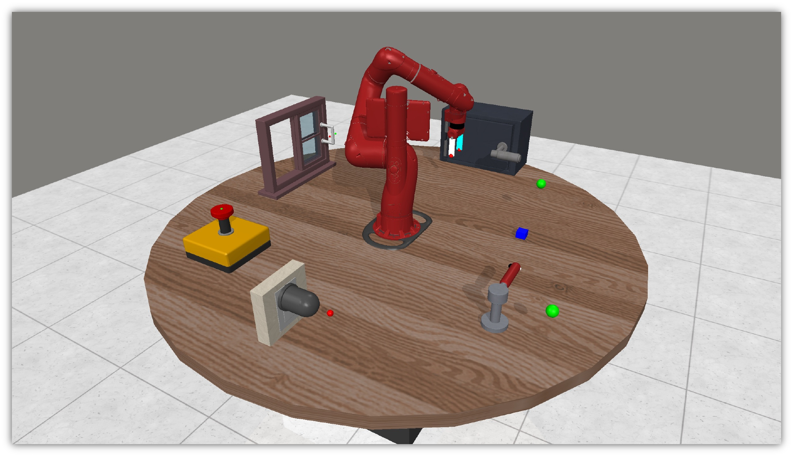

<div align="center">

# Continual RL Evaluation of Model Based and Model Free Algorithms (CREMMA)

**CREMMA is a training and evaluation platform for continual reinforcement learning on [ContinualBench](https://github.com/sail-sg/ContinualBench).** It extends the public Sawyer manipulation benchmark with vectorized training (`SubprocVecEnv` / `DummyVecEnv`), YAML configs (OmegaConf), and Weights & Biases logging, so model-free and model-based agents can be compared on the same sequential-task protocol.

The long-term goal is a shared platform for **model-free vs. model-based continual RL**, with new algorithms plugged in through a common `BasePolicy` interface.

</div>

<p align="center">
  
</p>

ContinualBench provides a single MuJoCo scene with six Sawyer-arm manipulation tasks. All tasks share the same physics, so an agent can be trained sequentially without changing the world model of the environment — only the active task (and its goal) changes.

**Original benchmark:** [Continual Reinforcement Learning by Planning with Online World Models](https://github.com/sail-sg/ContinualBench) (Liu et al., ICML 2025).

---

## Status

### Implemented

| Component | Location | Notes |
|:----------|:---------|:------|
| Vectorized training loop | `src/train.py` | Continual / random / single-task modes; one vectorized env per task; checkpointing |
| `BasePolicy` interface | `src/algorithms/basepolicy.py` | `predict`, `update`, `save`/`load`, `reset`, seed-episode collection |
| **SAC** | `src/algorithms/sac.py` | Twin critics, automatic entropy, delayed actor updates; trains online on each task |
| **Reset & Distill (RND)** | `src/algorithms/rnd.py` | Continual SAC: train online from scratch, distill into a persistent offline actor, regularize against stored expert snapshots |
| Goal-conditioned observations | `src/train.py` (`gcrl: true`) | Concatenate a 4D task-goal vector onto the 26D state (target xyz + door angle) |
| Replay / expert buffers | `src/buffer.py` | Flat transition replay for SAC; per-task expert snapshots (`mean`, `log_std`) for RND |
| CRL metrics + videos | `src/logger.py` | Online success, running regret, average performance (AP), eval videos via wandb |
| Hyperparameter search | `src/tune.py`, `src/tuner.py` | Optuna: single-task SAC (`block`); two-task RND (`block` → `button`) |

Naive sequential SAC (no reset, no distillation) is the same loop with `rnd=false`: the online agent is loaded from the previous task checkpoint and continues training.

### Not yet implemented

- **Dreamer** — first planned model-based agent, so CREMMA can compare MB and MF continual RL on the same benchmark. Not wired into training yet.

---

## Table of Contents

- [Installation](#installation)
- [Quick Start](#quick-start)
- [Implemented Algorithms](#implemented-algorithms)
  - [SAC](#sac)
  - [Reset & Distill](#reset--distill)
- [Benchmark Modes](#benchmark-modes)
- [Metrics](#metrics)
- [Hyperparameter Tuning](#hyperparameter-tuning)
- [Environment Details](#environment-details)
  - [Available Tasks](#available-tasks)
  - [Observation Space](#observation-space)
  - [Action Space](#action-space)
  - [Reward Structure](#reward-structure)
- [Customization](#customization)
- [Keyboard Control (Interactive Testing)](#keyboard-control-interactive-testing)
- [API Reference](#api-reference)
- [Roadmap](#roadmap)
- [License](#license)
- [Citation](#citation)

---

## Installation

```bash
git clone https://github.com/aahiljivani/CREMMA.git && cd CREMMA
pip install -e .
pip install stable-baselines3 shimmy omegaconf wandb torch
```

**Environment dependencies:** MuJoCo (`mujoco`), NumPy, OpenAI Gym (`gym`), and `glfw==2.5.0` (installed with the package). For Optuna sweeps also install `optuna`.

Headless eval rendering defaults to EGL (`MUJOCO_GL=egl` is set in `src/train.py`). Override with `MUJOCO_GL=osmesa` if no GPU display is available.

---

## Quick Start

Configs live under `cfgs/`. `policy` is required on the command line; everything else has defaults in `cfgs/default.yaml` and `cfgs/algorithms/sac.yaml`.

```bash
# Sequential SAC + Reset & Distill on the default 6-task order (1e6 env steps / task, 10 parallel envs)
python -m src.train policy=SAC

# Same, but naive sequential SAC (carry the online weights across tasks; no distillation)
python -m src.train policy=SAC rnd=false

# Single-task run
python -m src.train policy=SAC benchmark_mode=task single_task_name=block rnd=false

# Shuffled task order
python -m src.train policy=SAC benchmark_mode=random
```

Useful overrides:

```bash
python -m src.train policy=SAC num_envs=4 train.steps_per_task=100000 logging.enable_wandb=false
```

For a one-off random-policy smoke test of the environment:

```python
from continual_bench.envs import ContinualBenchEnv

env = ContinualBenchEnv(render_mode="rgb_array", seed=0)
env.set_task("button")
obs = env.reset()

for step in range(500):
    action = env.action_space.sample()  # 4D: [dx, dy, dz, gripper_effort]
    obs, reward, done, info = env.step(action)
    if done:  # Truncated at max_path_length
        obs = env.reset()
        break

env.close()
```

> **Note:** `step()` returns a **4-tuple** `(obs, reward, done, info)` (legacy Gym API). `reward` is a dict keyed by task name. Episodes are never terminated early except on success when wrapped for training; `done` is `True` at `max_path_length` (truncation).

---

## Implemented Algorithms

Every agent implements `src/algorithms/basepolicy.py`. The training loop in `ContinualBenchVecEnv.train()` is algorithm-agnostic except for the RND distillation hook after each task.

### SAC

`src/algorithms/sac.py` is a PyTorch Soft Actor-Critic agent for ContinualBench’s continuous 4D action space:

- MLP actor with tanh-squashed Gaussian (`mean`, `log_std`)
- Twin Q-networks with LayerNorm, orthogonal init, and delayed policy updates
- Automatic entropy temperature (`autotune: true`)
- Soft target updates (`tau: 0.005`)
- Random seed episodes until `learning_starts`, then gradient updates from `ReplayBuffer`

Default hyperparameters are in `cfgs/algorithms/sac.yaml` (`hidden_size: 256`, `batch_size: 256`, replay size `1e6`, `policy_lr` / `q_lr` `3e-4`).

When `gcrl: true` (default), observations are 30D: the 26D state plus a 4D goal `[target_x, target_y, target_z, door_angle]`. The goal is the task’s target position (door angle is `π/2 + π/6` for `door`, else `0`).

### Reset & Distill

Enabled with `rnd: true` (default). After each task’s online SAC budget:

1. **Reset.** The online SAC actor/critics are trained from scratch on the current task (previous-task checkpoints are not loaded).
2. **Collect expert data.** Stochastic rollouts of the finished online actor fill a target replay buffer (`target_replay_buffer_size`, default `1e6`).
3. **Distill.** A persistent offline actor is trained with KL(online ‖ offline) on that buffer.
4. **Regularize.** A behavior-cloning KL against stored expert snapshots from *earlier* tasks (`ExpertBuffer`, `expert_buffer_size: 10_000` per task, coefficient `cl_reg_coef`) reduces forgetting.
5. **Store.** A subset of the current task’s observations and online `(mean, log_std)` is written into the expert buffer for future tasks.
6. **Eval.** The distilled actor is evaluated on every task seen so far (this is AP). Online SAC is then reset for the next task; the offline actor is kept.

This follows the Reset & Distill continual-RL protocol: the online learner is free to specialize, and a single offline policy accumulates skill.

---

## Benchmark Modes

Set via `benchmark_mode` (or by merging `cfgs/continual.yaml`, `cfgs/random.yaml`, `cfgs/task.yaml`):

| Mode | Behavior |
|:-----|:---------|
| `continual` | Train tasks in `task_list` order. Default: `block → button → door → peg → window → faucet`. |
| `random` | Shuffle `task_list` with `seed`. |
| `task` | Train only `single_task_name`. |

Each task gets `train.steps_per_task` environment steps (summed across `num_envs` workers). The default is **1,000,000 steps × 6 tasks** with **10** `SubprocVecEnv` workers.

After a task finishes, the current policy is evaluated for `eval.num_eval_episodes` (default 20) greedy episodes on **every seen task**. Checkpoints are written to `models/<policy>_<mode>_<n>env_seed<seed>/`.

---

## Metrics

`ContinualLogger` logs to wandb (`logging.project`, `logging.wandb_entity`):

| Metric | Meaning |
|:-------|:--------|
| `train_final_success_<task>` | Rolling window of episodic success on the task currently being trained |
| `regret_running` | Time-weighted area between the online success curve and an oracle of 1 |
| `eval_success_<task>` | Greedy success rate of the *current* policy on a previously seen task |
| `AP` | Average performance: mean of `eval_success_*` over all tasks seen so far (forgetting-aware) |
| `eval/video_<task>` | Mid-training deterministic rollout |
| `eval/offline_video_<task>` | Distilled-actor rollout after RND (when `rnd: true`) |

Online success is computed from **episode outcomes**, not the raw per-step `info["success"]` flag (that flag is 0 on almost every timestep and would pin regret near 1).

---

## Hyperparameter Tuning

```bash
python -m src.tune    # SAC on `block` only
python -m src.tuner   # RND on `block` → `button`, scored across seeds
```

`src/tune.py` runs Optuna trials of single-task SAC. `src/tuner.py` runs multi-seed RND trials on a two-task prefix and scores the distilled actor with weighted success (`block` 0.6, `button` 0.4).

---

## Environment Details

### Available Tasks

All six tasks share a single Sawyer robot arm and a common physical scene:

| Index | Task Name | Description | Success Criterion |
|:-----:|:---------:|:------------|:-----------------:|
| 0 | `button` | Press a button downward | `obj_to_target ≤ 0.024` |
| 1 | `door` | Open a door by its handle | `obj_to_target ≤ 0.08` |
| 2 | `window` | Slide a window open | `target_to_obj ≤ 0.05` |
| 3 | `faucet` | Turn a faucet handle | `target_to_obj ≤ 0.07` |
| 4 | `peg` | Insert a peg into a hole | `obj_to_target ≤ 0.07` |
| 5 | `block` | Push/pick a block to a target | `obj_to_midpoint ≤ 0.05` |

Access the full list programmatically:

```python
print(env.all_tasks)  # ['button', 'door', 'window', 'faucet', 'peg', 'block']
```

### Observation Space

The observation is a **26-dimensional** `float64` vector containing:

| Indices | Description |
|:-------:|:------------|
| `0:3` | End-effector (hand) position `[x, y, z]` |
| `3` | Gripper openness (normalized `0.0`–`1.0`) |
| `4:7` | Button position |
| `7:10` | Door handle position |
| `10` | Door joint angle |
| `11:14` | Window handle position |
| `14:17` | Faucet handle position |
| `17:20` | Peg end position |
| `20:23` | Block position |
| `23` | Gripper direction (delta openness) |
| `24` | Left pad Y offset from hand |
| `25` | Right pad Y offset from hand |

> All object states are present in every observation regardless of the active task, enabling the agent to observe all tasks simultaneously.

When `gcrl: true`, training concatenates a 4D goal, so the policy sees **30D** observations.

### Action Space

A **4-dimensional** continuous `Box([-1, -1, -1, -1], [+1, +1, +1, +1])`:

| Index | Description |
|:-----:|:------------|
| `0` | Δx (end-effector position delta) |
| `1` | Δy (end-effector position delta) |
| `2` | Δz (end-effector position delta) |
| `3` | Gripper effort (`-1` = open, `+1` = close) |

Actions are scaled by `action_scale = 1/100` before being applied to the mocap body.

### Reward Structure

`env.step()` returns rewards as a **dictionary** keyed by task name. Each task's reward is in the range `[0, 10]` (with the exception of `block` which can return `-10` if the block falls off the table). Each task uses a shaped reward composed of reach, grasp, and in-place components.

```python
obs, reward_dict, done, info = env.step(action)

current_reward = reward_dict["door"]

door_info = info["door"]
print(door_info["success"])       # bool: whether task is solved
print(door_info["obj_to_target"]) # float: distance to goal
```

---

## Customization

### Setting a Specific Task

Use `set_task()` to select which task the robot should focus on. This determines the hand's initial position and which camera angle is active. **You must call `reset()` after switching tasks.**

```python
env = ContinualBenchEnv(render_mode="rgb_array", seed=0)

env.set_task("window")  # One of: 'button', 'door', 'window', 'faucet', 'peg', 'block'
env.reset()
```

> **Default behavior:** If `set_task()` is never called explicitly, the environment initializes to the first task (`"button"`).

### Episode Length (Max Steps)

Each episode is **fixed at 500 steps** (`max_path_length = 500`). The episode is truncated (not terminated) when this limit is reached.

```python
print(env.max_path_length)  # 500

env = ContinualBenchEnv(render_mode="rgb_array", seed=0)
env.max_path_length = 200  # Shorter episodes for faster iteration
```

> **Important:** The environment raises a `ValueError` if you call `step()` after `max_path_length` is reached without calling `reset()` first.

### Render Modes

```python
env = ContinualBenchEnv(render_mode="rgb_array", seed=0)
pixels = env.render()  # HxWx3 numpy array

env = ContinualBenchEnv(render_mode="human", seed=0)

env = ContinualBenchEnv(render_mode="depth_array", seed=0)
```

Default resolution is **480×480**. Default render FPS is **80**.

### Seeding for Reproducibility

```python
env = ContinualBenchEnv(render_mode="rgb_array", seed=42)
```

When `seed` is provided, the global `np.random` state is temporarily modified during initialization and then restored.

### Manual SubprocVecEnv Setup

```python
import numpy as np
from stable_baselines3.common.vec_env import SubprocVecEnv
from continual_bench.envs import ContinualBenchEnv
from shimmy.openai_gym_compatibility import GymV21CompatibilityV0

def make_env(env_id, seed=0):
    def _init():
        env = ContinualBenchEnv(render_mode="rgb_array", seed=seed + env_id)
        env.set_task("door")
        return GymV21CompatibilityV0(env=env)
    return _init

num_envs = 4
vec_env = SubprocVecEnv([make_env(i) for i in range(num_envs)])
obs = vec_env.reset()
vec_env.close()
```

The supported training entry point already does this (plus goal augmentation and Gymnasium bridging) inside `ContinualBenchVecEnv`.

---

## Keyboard Control (Interactive Testing)

```bash
python tests/keyboard_control.py
```

**Key Bindings:**

| Key | Action |
|:---:|:-------|
| `W/A/S/D` | Move end-effector in XY plane |
| `K/J` | Move end-effector up/down (Z axis) |
| `H` | Close gripper |
| `L` | Open gripper |
| `R` | Reset environment |
| `0–5` | Switch task (0=button, 1=door, ..., 5=block) |

---

## API Reference

### `ContinualBenchEnv(render_mode=None, seed=None)`

| Method | Description |
|:------:|:------------|
| `set_task(task_name: str)` | Set active task. One of `'button'`, `'door'`, `'window'`, `'faucet'`, `'peg'`, `'block'`. Must call `reset()` after. |
| `reset()` | Reset environment to initial state for current task. Returns observation. |
| `step(action)` | Execute action. Returns `(obs, reward_dict, done, info)`. |
| `render()` | Render current frame according to `render_mode`. |
| `get_init_state()` | Get initial state data (useful for model-based RL). |
| `close()` | Clean up renderer resources. |

| Attribute | Type | Description |
|:---------:|:----:|:------------|
| `all_tasks` | `list[str]` | All available task names |
| `task_spec` | `TaskSpec` | Current task's name, hand init position, and object init position |
| `max_path_length` | `int` | Maximum steps per episode (default: `500`) |
| `action_space` | `Box` | 4D continuous action space |
| `observation_space` | `Box` | Observation space |

---

## Roadmap

1. **Dreamer** — add a model-based agent on the same `BasePolicy` + ContinualBench loop, so SAC / RND can be compared against a learned world model.
2. Further model-based continual RL methods on top of that world-model stack.
3. Broader task-order and seed studies on the existing SAC / RND pipeline.

---

## License

`continual-bench` is distributed under the terms of the [MIT](https://spdx.org/licenses/MIT.html) license.

## Citation

If you find the ContinualBench environment useful, please cite:

```bibtex
@inproceedings{liu2025continual,
  title={Continual Reinforcement Learning by Planning with Online World Models},
  author={Liu, Zichen and Fu, Guoji and Du, Chao and Lee, Wee Sun and Lin, Min},
  booktitle={International Conference on Machine Learning},
  year={2025}
}
```
