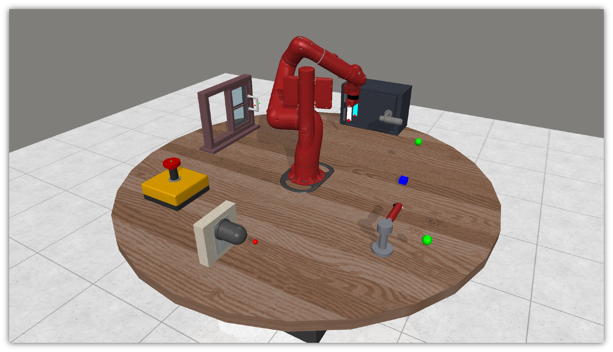

# Continual SAC (CSAC) on ContinualBench

CSAC currently only applies **Reset & Distill (R&D)** to **Soft Actor-Critic** on [ContinualBench](https://github.com/sail-sg/ContinualBench), a single MuJoCo scene with six Sawyer-arm manipulation tasks trained one after another. Training is parallelized across CPU workers with Stable-Baselines3's `SubprocVecEnv`.

<p align="center">
  
</p>

## Status

Work in progress. The R&D + SAC agent learns **3–4 of the 6 tasks**; which ones varies by seed (`button`, `door`, `window`, `faucet`, `peg`). The pick-and-place cube task (`block`) was never learned by the online agent at any point in training, under any hyperparameter configuration tried, so it is never distilled.

### Next steps

A continual RL agent should never stop learning ([Abel et al., 2023](https://arxiv.org/abs/2307.11046)). I am considering two directions:

1. **Make the distilled actor a learner.** R&D's offline actor only imitates frozen experts and never learns from reward. Pairing it with a critic, either warm-started from the online critic or using a normalized critic architecture, would let one persistent agent keep improving after distillation.
2. **Multi-task pre-training, then continual learning.** Pre-train a policy with multi-task RL on all 6 tasks, then deploy it as a continual learner that keeps adapting after pre-training.

I currently lean towards option 2. For it to count as continual learning, the post-pre-training phase must include something not seen during pre-training (new tasks, task variations, or dynamics shifts). Otherwise it only measures retention.

## Method

For each task in sequence (`block → button → door → peg → window → faucet` by default):

1. **Reset**: train a fresh online SAC agent on the current task.
2. **Collect**: roll out the trained online policy stochastically to build a distillation buffer.
3. **Distill**: train a persistent offline actor to match the online policy with a KL loss, plus a behavior-cloning KL against stored snapshots from earlier tasks to limit forgetting.
4. **Evaluate**: run the distilled actor on every task seen so far and log average performance (AP).

The code lives in `src/algorithms/sac.py` (SAC), `src/algorithms/rnd.py` (R&D), and `src/train.py` (vectorized continual training loop). Hyperparameters are in `cfgs/default.yaml` and `cfgs/algorithms/sac.yaml`.

## Setup

```bash
git clone https://github.com/aahiljivani/CREMMA.git
cd CREMMA

python3.10 -m venv .venv
source .venv/bin/activate

pip install -e .
pip install torch mujoco gym numpy dm-tree stable-baselines3 shimmy omegaconf wandb tqdm
wandb login   # optional; pass --no-wandb to skip
```

Eval rendering uses EGL by default (`MUJOCO_GL=egl`). On machines without a GPU, set `MUJOCO_GL=osmesa`.

## Reproducing results

```bash
scripts/reproduce.sh                              # R&D + SAC, default task order, seed 0
scripts/reproduce.sh --seeds "0 1 2" --no-wandb   # several seeds, no wandb logging
scripts/reproduce.sh --no-rnd                     # naive sequential SAC baseline
scripts/reproduce.sh -- cl_reg_coef=0.5           # pass any config override through
```

The script calls `python -m src.train policy=SAC ...` with the defaults: 1M environment steps per task and 10 parallel envs. Checkpoints are written to `models/`.

## Future work for ContinualBench
- **GPU-parallel ContinualBench**: training currently runs on CPU through `SubprocVecEnv`, because the scene has too many dynamic object collisions to port easily. Moving the simulation to the GPU with MJWarp is left for later. Or we can port the same environment to ManiSkill3 (considering the latter option rather than the former)

## Citation

ContinualBench comes from:

```bibtex
@inproceedings{liu2025continual,
  title={Continual Reinforcement Learning by Planning with Online World Models},
  author={Liu, Zichen and Fu, Guoji and Du, Chao and Lee, Wee Sun and Lin, Min},
  booktitle={International Conference on Machine Learning},
  year={2025}
}
```

ContinualBench is released under the MIT license (`continual_bench/LICENSE.txt`).
